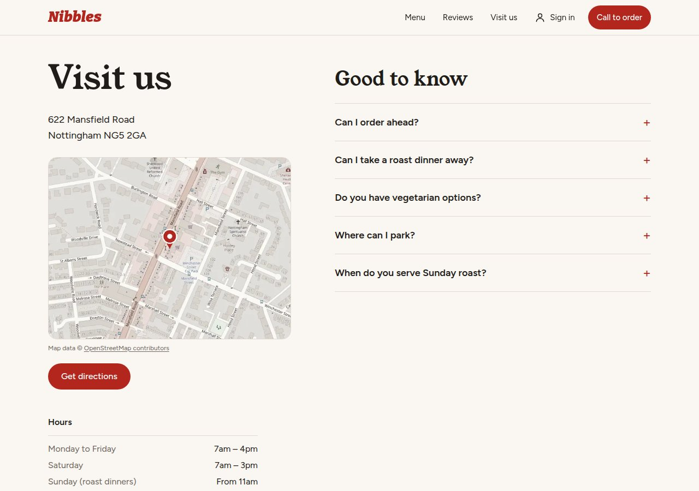
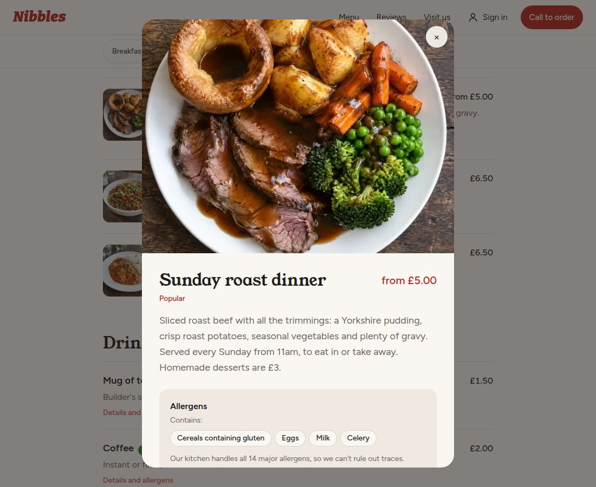
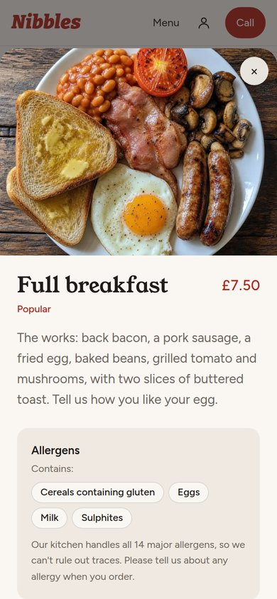

## Building a restaurant website, step by step

I'm building a website for a local café in Nottingham, and turning it into a template I can set up for other restaurants. This is how it came together.

  
  

### 1. Planning before coding

Before writing any code, I wrote a plan: what the café needs (a menu, ordering, reviews, accounts), who uses the site (customers, staff, managers and the owner), and the big decisions. The biggest was to build it as a **template**, so every detail that changes between restaurants lives in one settings file and a new restaurant can be set up in minutes.

### 2. Making it look like the real café

I started from a photo of the shop front. The logo uses **Bitter Black Italic**, the closest free font to the lettering on the sign, in the shop's red, with warm neutral colours around it. The sign also had details the internet didn't: the real phone number, the Sunday roast from 11am and buffets for all occasions. All of those went onto the site.

### 3. Food photos that move

The dish photos were made with AI through ImageKit. On the home page, the main photo slowly zooms and fades between dishes, with a pause button and a still version for anyone who turns off motion on their device.

*Lesson learned:* asking ImageKit for a resized copy before an AI photo had finished made it remember an error for that address. Now I wait for the full-size photo first.

### 4. A secure database

The back end runs on **Supabase**. Every table is locked down with row level security: customers only see their own orders and reviews, staff can't change prices, customers never see food costs, and only the owner sees the activity log. **50 automated checks** prove each rule works.

### 5. Reviews and a map

Customers can leave a star rating and a review, but nothing goes live until the owner approves it. The Visit us page has a map made from OpenStreetMap. A live map needed 3D graphics some phones don't support, so I made it a ready-made image instead: it loads instantly and taps through to directions.

### 6. Customer accounts

Customers can sign up, sign in, reset their password, and see their details and reviews on an account page. The confirmation and password-reset emails are designed in the café's colours.

### 7. Dish details and allergens

Tapping any dish opens a bigger photo, a fuller description, dietary symbols (V, VG, GF and a chilli for spicy) and which of the UK's 14 major allergens it contains. The allergen lists are placeholders until the café confirms its recipes.

  
  

### 8. Phones and iPads

I tested every page at 8 screen sizes, from small phones to a landscape iPad Pro: **48 checks** with no sideways scrolling and every button at least 44px tall for fingers. Customers can also add the site to their home screen, where it opens like an app with its own icon.

### What's next

- Online ordering for pickup and from the table with a QR code
- Card payments
- A live order board for staff and profit reports for the manager
- A domain name, an email service for account emails, and going live

### Tools

Next.js, React, TypeScript, Tailwind CSS, Supabase, ImageKit, Higgsfield and GitHub, with Claude Code (an AI coding assistant) as my pair programmer.
