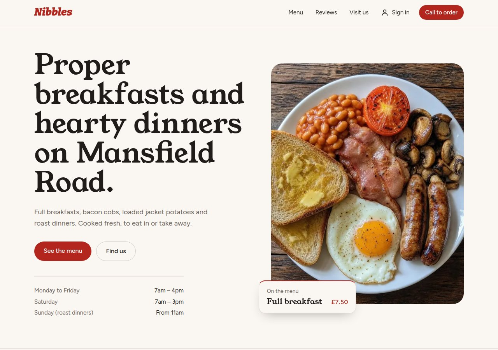
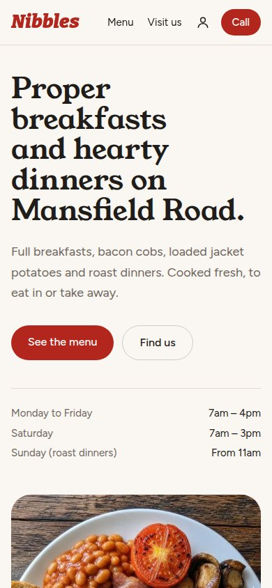

### Hi, I'm Samarpan

I'm a freelance web developer. I build fast, modern websites for small businesses, especially restaurants, cafés and takeaways, so customers can find you, see what you sell and order without picking up the phone.

## What I can build for you

- **A website that looks like your business:** your name, colours and photos, and easy to read on a phone
- **Online menus** with prices, photos and dietary labels you can update yourself
- **Ordering and bookings:** pickup orders, ordering from the table, and reservations
- **Customer accounts and reviews** so regulars can sign in and leave feedback you approve first
- **Maps, opening hours and contact details** that are always up to date
- **A secure back end** with the customer data locked down properly

## Recent work

**Restaurant website template:** a concept site for a local café, with a menu, moving photos of the food, reviews, customer accounts and a map. It's built to be set up for a new restaurant in minutes.

  
  

## Tools I use

Next.js, React, TypeScript, Tailwind CSS, Supabase, ImageKit and Vercel.

## Work with me

Run a restaurant, café or small business and want a better website? Get in touch.
